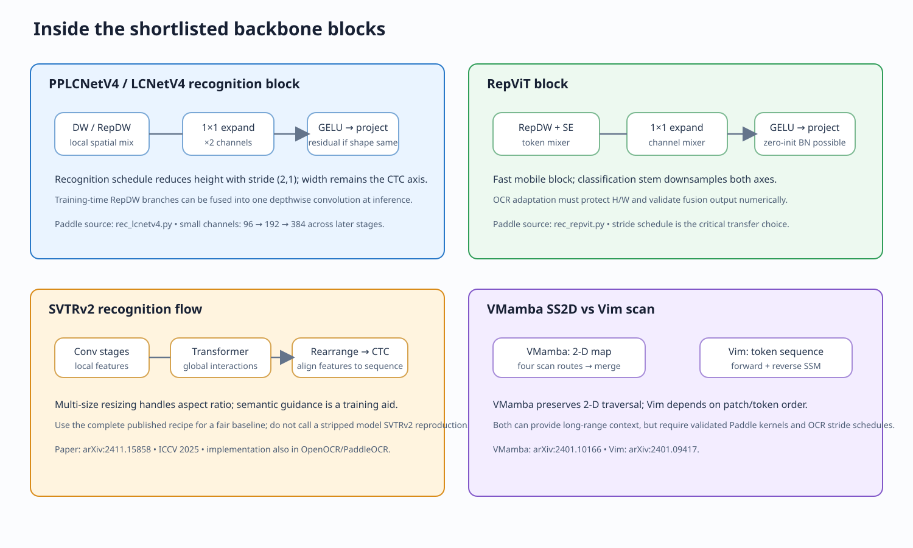

# Backbone architecture deep dive for CTC OCR

**Purpose:** explain how each shortlisted backbone transforms pixels into a sequence, where information is lost, and where alignment can be inserted.
**Reading order:** tensor contract → block internals → OCR-specific consequences → integration plan.
**Evidence rule:** architecture facts are attributed to the cited paper or source implementation. OCR-specific consequences are engineering analysis, not published benchmark claims.

> **Main conclusion:** the important decision is not simply “CNN or Transformer”. It is **where the model reduces height/width, how it mixes spatial positions, and whether it exposes a 2-D feature map before CTC collapses it to timesteps**.

## 1. Recognition tensor contract

For a recognizer input `X ∈ R^(B×3×H×W)`, the visual model should expose a map `F ∈ R^(B×C×H'×W')`. The sequence encoder maps it to `Z ∈ R^(B×T×D)`, then the CTC classifier returns `L ∈ R^(B×T×V)`.

```text
image X (B,3,H,W)
  → visual stages: F (B,C,H',W')
  → optional 2-D alignment: F' (B,C,H',W')
  → vertical collapse / sequence encoder: Z (B,T,D)
  → linear projection: logits (B,T,V)
  → CTC collapse and decode
```

For meter strips, preserve **horizontal resolution** until CTC. Vertical reduction is usually less harmful after enough local stroke features are encoded, but early height collapse can erase seven-segment boundaries, decimal marks, and narrow gaps. Every candidate must log actual intermediate shapes for the real configured image sizes. Do not infer shapes from a model name.




## 2. PPLCNetV4 recognition path — precise local implementation analysis

The checked PaddleOCR `rec_lcnetv4.py` defines separate detection and recognition configurations. These are not interchangeable. Recognition mode returns a pooled feature of shape `(B,C,1,W')`; detection mode returns a four-level feature pyramid. The existing PP-OCRv6 small recognition YAML selects `model_size: small`, a light-SVTR CTC neck (`dims=120`, `depth=2`, `local_kernel=7`), and a `MultiHead` containing CTC and NRTR paths in the official general OCR recipe. EditCTC's local CTC-only / high-resolution variants differ and must be analyzed from their exact YAML and head implementation.

### 2.1 Recognition stage construction

For `model_size=small`, source declares:

| Component | Channels | Stride behavior | What it does |
|---|---:|---|---|
| Branch stem | 3 → 48 → 96 | stem convs have stride 2; branch fusion then stride 2 | Captures early edges with a multi-branch stem. |
| `blocks2` | 96 → 96 | stride 1 | One light channel/spatial mixing block. |
| `blocks3` | 96 → 96 | stride 1 | Two blocks; depth grows while feature grid stays stable. |
| `blocks4` | 96 → 192 | first block stride `(2,1)` | Reduces height and increases channels, while retaining width. |
| `blocks5` | 192 → 384 | first block stride `(2,1)` | Further height reduction, unchanged width. |
| `blocks6` | empty in small recipe | none | No extra stage. |
| Recognition pooling | 384 channels | eval uses `(3,2)` average pool; training uses adaptive `(1,40)` | Produces the sequence-like map consumed by the head. |

Exact output width depends on input width, padding, and train/eval path. The code's training adaptive pooling to width 40 and evaluation pooling are not identical operations. Test-time shape and train-time shape must be measured and verified for the exact version used. This is an important reproducibility issue, not a footnote.

### 2.2 LCNetV4 block internals

A normal block has two conceptual mixers:

1. **Token/spatial mixer.** A depthwise spatial convolution, generally `3×3`. When stride is one and channels are unchanged, `RepDWConv` evaluates a `3×3` depthwise branch, a `1×1` depthwise branch, and identity in parallel during training; inference can fuse them into one depthwise convolution.
2. **Channel mixer.** `1×1 expand → GELU/activation → 1×1 compress`, with expansion ratio 2 in this recognition config. A residual is added when input/output channel counts and stride allow it. Optional SE uses global average pooling and channel gates.

Compact form:

```text
U = DWConv_or_RepDW(X)             # spatial/local mixing
V = Conv1x1_compress(Act(Conv1x1_expand(U)))
Y = U + V                          # only for stride=1 and same channels
```

**Why this suits CTC:** depthwise spatial filters preserve a regular grid, and recognition stages intentionally reduce height without downsampling width. Thus the width axis remains a plausible temporal axis. The local implementation also supports exact conv/BN fusion via `rep()`.

**Limit:** the block's spatial operator remains local. Any long-range relation across distant digits is left to light-SVTR. An alignment block should be attached before final vertical pooling if it is meant to correct 2-D displacement. Attaching after the map is `(B,C,1,W')` can only adjust a 1-D sequence; it cannot recover vertical location lost by pooling.

**EditCTC insertion points:**

- **Low-risk:** after `blocks5`, before recognition pooling, with a residual module preserving `(B,384,H',W')`.
- **Very low-cost:** after pooling / before light-SVTR, but describe it as temporal alignment, not spatial alignment.
- **High-resolution side path:** if the model exposes an earlier feature, verify its real channels and `(H',W')`; do not hard-code the existing config's `384×4×96` without runtime evidence for the selected PaddleOCR revision.

Source code: [PaddleOCR `rec_lcnetv4.py`](https://github.com/PaddlePaddle/PaddleOCR/blob/main/ppocr/modeling/backbones/rec_lcnetv4.py), [PP-OCRv6 small recognition YAML](https://github.com/PaddlePaddle/PaddleOCR/blob/main/configs/rec/PP-OCRv6/PP-OCRv6_small_rec.yml).

## 3. PPHGNetV2 — why it is a control, not just a “bigger CNN”

PaddleOCR's recognition implementation imports a hierarchical HGNetV2 design with **Diverse Branch Blocks (DBB)** and channel transition/stage logic. In the training graph, a DBB may contain an origin convolution branch, an average-pooling branch, a `1×1` branch and an identity-related branch, followed by activation. Algebraic transformations fold the linear branches and batch normalization into one deploy convolution.

```text
Training:  [3×3 Conv-BN] + [1×1 → BN/pad → AvgPool] + [1×1 Conv-BN] + [identity]
                  → sum → nonlinearity
Deploy:                  fused k×k Conv
```

### What changes relative to PPLCNetV4

- **Feature aggregation:** multiple linear receptive-field paths are optimized jointly in training; after re-parameterization inference is a conventional convolution.
- **Capacity:** wider/deeper stage configurations provide a stronger server-class control. Exact channel counts and strides are configuration-specific.
- **Alignment interaction:** DBB itself does not predict sample offsets. It learns a richer but still fixed-grid convolutional basis. A deformable residual after a stage adds dynamic geometry, so the experiment separates “more fixed capacity” from “adaptive coordinates”.

### OCR trade-offs

**Advantages:** direct PaddleOCR pathway; strong fixed-grid features; training-time branch diversity can improve optimization while deploy-time fusion avoids keeping all branches.
**Disadvantages:** more compute/memory than the small LCNet path; conversion/fusion must be tested; if one changes stage strides, pretrained tensor matching and the CTC time length change.

**Fair control:** use the official PP-OCRv5 server config/checkpoint as a complete recipe, then replace only the neck/head portions required to match CTC. Log which backbone tensors loaded and which modules were newly initialized. Do not call a partly matched checkpoint a full pretrained initialization.

Source code: [PaddleOCR `rec_pphgnetv2.py`](https://github.com/PaddlePaddle/PaddleOCR/blob/main/ppocr/modeling/backbones/rec_pphgnetv2.py).

## 4. SVTRv2 — a CTC recognizer architecture, not an interchangeable visual trunk

SVTRv2 is especially relevant because it directly addresses CTC recognition. Its paper introduces two OCR-specific mechanisms on top of visual modeling:

1. **Multi-size resizing:** choose among predefined input geometries to avoid severe distortion of text with different aspect ratios.
2. **Feature rearrangement:** reorganize visual features so the spatial feature sequence better fits CTC's monotonic alignment assumptions.
3. **Semantic guidance:** inject language/semantic context during training; the paper states this module can be omitted at inference, avoiding additional inference cost.

The repository implementation uses a hybrid visual stack: convolutional blocks perform local spatial mixing; transformer blocks use `Q,K,V` self-attention and MLP residuals; subsampling transitions alter height/width and channel dimensions. Therefore “SVTRv2 backbone” may include OCR-specific stages and sequence operations, not merely a generic image encoder followed by CTC.

### Why feature rearrangement matters for meter digits

CTC assumes each output timestep aligns monotonically to the target label sequence. If a character's visual evidence is distributed across a 2-D patch, naive flattening (for example row-major flattening) can make one glyph occupy an inconsistent run of positions. Feature rearrangement is designed to make the sequence order more compatible with recognition. For meter strings, test whether it helps digits that are tilted, tightly spaced, or have variable widths; do not assume benefit from its scene-text benchmark alone.

### Trade-offs and integration

**Advantages:** recognition-specific inductive bias; CTC remains the output head; semantic guidance may improve training without a runtime branch; source reports evaluation across irregularity/long-text scenarios.
**Disadvantages:** resize strategy and rearrangement are coupled to its recipe; replacing its head/neck may remove the paper's key contribution; exact vocabulary/pretraining and input sizes need auditing.

**Recommendation:** use the official SVTRv2 config as a separate end-to-end CTC baseline. For a backbone-only comparison, explicitly disable or hold constant rearrangement and semantic guidance, then state that this is a modified variant—not SVTRv2 reproduction.

Source: [SVTRv2, arXiv:2411.15858](https://arxiv.org/abs/2411.15858), [OpenOCR](https://github.com/Topdu/OpenOCR), [PaddleOCR `rec_svtrv2.py`](https://github.com/PaddlePaddle/PaddleOCR/blob/main/ppocr/modeling/backbones/rec_svtrv2.py).

## 5. RepViT — mobile token mixer plus re-parameterizable blocks

The checked PaddleOCR `rec_repvit.py` implementation provides a useful precise view. Its stem performs two `3×3`, stride-2 convolutions. The main block has:

- **Token mixer:** for same-shape blocks, a re-parameterizable depthwise spatial block (3×3 DW + 1×1 DW + identity during training), optionally followed by squeeze-excitation.
- **Channel mixer:** `1×1 expand → GELU → 1×1 project`, wrapped in a residual. The final BN scale can be initialized to zero to make the residual branch start near identity.
- **Downsampling block:** depthwise spatial convolution with stride, optional SE, then pointwise projection; the channel mixer follows.
- **Deploy conversion:** fuse depthwise branch/identity and conv-BN components where supported.

### OCR implications

RepViT keeps a 2-D map and has a direct local implementation in the PaddleOCR source snapshot. That lowers implementation risk relative to importing an unrelated PyTorch model. Its main concern for digits is downsampling: the classification stem already reduces both spatial axes; an OCR version should reconsider early strides, especially vertical/horizontal stride separately. A classification checkpoint can initialize matching blocks, but shape changes in the stem/stage widths will prevent exact transfer for those tensors.

**Best test:** adapt only the stride schedule needed to keep sufficient `W'`, load all shape-compatible pretrained weights, report the exact matched fraction, and compare against PPLCNetV4 at the same target-device latency. Test deploy-fused output against unfused output numerically.

Source: [PaddleOCR `rec_repvit.py`](https://github.com/PaddlePaddle/PaddleOCR/blob/main/ppocr/modeling/backbones/rec_repvit.py), [RepViT project](https://github.com/THU-MIG/RepViT).

## 6. MobileNetV4 — Universal Inverted Bottleneck (UIB) and Mobile MQA

The paper's central building block, **UIB**, is a configurable mobile block that can arrange pointwise expansion, depthwise spatial filtering, and pointwise projection in several orders. It unifies inverted bottleneck, ConvNeXt-like, FFN-like, and ExtraDW-like patterns. Its purpose is to let hardware-aware search select which operations are useful on each device. **Mobile MQA** is a mobile-oriented multi-query attention component that reduces key/value work relative to conventional multi-head attention. The paper's reported runtime and accuracy are device- and model-specific.

```text
UIB (one family, multiple layouts)
  pointwise expand? → depthwise conv? → extra depthwise? → pointwise project
  residual only when stride/channel contract permits

Mobile MQA
  many query heads share a smaller key/value representation
  → lower attention memory/compute than independent K/V heads
```

### OCR implications

UIB offers knobs that can preserve more high-resolution spatial features while keeping per-pixel operations efficient. But the classification architecture's searched stage schedule is not guaranteed to be suitable for narrow text crops. In particular, symmetric image downsampling wastes height resolution and can reduce the CTC timestep count through width reduction.

**Potential advantages:** broad mobile hardware target; composable block family; operator patterns are mostly standard conv/attention operations.
**Potential disadvantages:** no direct EditCTC OCR checkpoint; NAS-derived stage choices may not transfer to aspect-ratio-heavy text; Mobile MQA may add little for short strings already handled by light-SVTR.

**Integration gate:** before training, calculate the receptive field and cumulative stride in both axes. Keep width stride modest enough that `T` comfortably exceeds target label length. Record per-device latency; the paper's EdgeTPU timing cannot be transferred to this project's GPU/CPU.

Source: [MobileNetV4, arXiv:2404.10518](https://arxiv.org/abs/2404.10518).

## 7. StarNet — multiplicative “star” feature interaction

StarNet's core operation is element-wise multiplication of two projected feature streams. A simplified block is:

```text
u = Conv1x1(X)
v = Conv1x1(X)
z = u ⊙ v
Y = projection(z) + X
```

The authors interpret multiplication as a low-cost nonlinear feature interaction akin to mapping into a richer feature space without simply widening every layer. The actual network adds normalization, spatial convolution, and residual/stage structure; the pseudocode above describes the central interaction, not the full paper implementation.

**OCR opportunity:** multiplicative interaction can gate stroke/channel responses cheaply.
**OCR risk:** multiplicative values can amplify sensor noise, glare, and contrast changes; unlike attention or a sequence mixer, this operator does not itself route information from distant timesteps. Keep a standard residual and compare under matched compute.

Source: [Rewrite the Stars / StarNet, arXiv:2403.19967](https://arxiv.org/abs/2403.19967), [official code](https://github.com/ma-xu/Rewrite-the-Stars).

## 8. VMamba — four-route 2-D selective scan

VMamba's VSS block applies local projection/convolution and selective state-space mixing. Its **SS2D** converts a 2-D feature grid into scan sequences along four traversals, applies selective scans, and merges outputs back to the grid. This provides global context with a linear-in-token-count scan formulation; it does not mean the real kernel is automatically faster at every resolution or device.

```text
F (B,C,H,W)
  → project / local spatial processing
  → serialize along 4 scan routes
  → selective state-space recurrence per route
  → reverse/align routes and merge
  → projection + residual
```

### OCR implications

The horizontal route can propagate context along the reading direction. The vertical and reverse routes add two-dimensional context, which may help with character shape and illumination. But all four routes may be wasteful for a strip where width dominates; route fusion can also introduce memory movement and kernel overhead. A 1-D horizontal selective scan is a plausible OCR adaptation but is a **new model**, not stock VMamba.

**Recommendation:** only test if error analysis shows long-range visual context or illumination drift is a leading failure mode. Use a narrow model and compare four-route SS2D against horizontal-only scan and light-SVTR at matched latency.

Source: [VMamba, arXiv:2401.10166](https://arxiv.org/abs/2401.10166), [official code](https://github.com/MzeroMiko/VMamba).

## 9. Vision Mamba (Vim) — bidirectional scan over image tokens

Vim patchifies the image into tokens, adds position information, and uses bidirectional Mamba blocks to process token sequences. The forward and reverse directions allow each token to receive context from both sides. This differs from VMamba: Vim is primarily sequence processing over a tokenized image, while VMamba explicitly adapts scanning to a 2-D map with multiple routes.

**Advantages:** two-sided context without full pairwise attention; potentially efficient at high token counts.
**Disadvantages:** patch embedding can discard fine pixel-level stroke structure; raster token order may not match text reading order; pretrained weights are tied to patch and positional conventions.

For OCR, replace generic square patching with a shape-aware stem or use a 2-D CNN stem before the scan. Preserve a known mapping from token index to horizontal coordinate. Without that mapping, adding CTC positional/alignment bias is poorly defined.

Source: [Vision Mamba, arXiv:2401.09417](https://arxiv.org/abs/2401.09417), [official code](https://github.com/hustvl/Vim).

## 10. MambaVision — CNN hierarchy, Mamba stages, late attention

MambaVision is a hierarchical hybrid. It uses convolutional stages for early local visual processing, Mamba blocks for efficient context mixing, and self-attention in later stages. The paper's ablations motivate attention in late stages to improve long-range spatial dependency modeling. It is not a single Mamba operator replacing all convolutions.

**Advantages:** local-to-global progression; late global attention can model interactions between distant visual regions; hierarchical stages can expose feature maps.
**Disadvantages:** mixed operator stack complicates conversion and deployment; attention cost may be unjustified for short digit strings; generic classification stages may downsample too aggressively.

For a meter OCR port, inspect every stage's stride and retain a high-resolution feature for alignment. If only the final low-resolution stage is connected to CTC, much of the hybrid architecture's spatial detail is already gone.

Source: [MambaVision, arXiv:2407.08083](https://arxiv.org/abs/2407.08083), [official code](https://github.com/NVlabs/MambaVision).

## 11. DCNv4 — operator insertion analysis

DCNv4 is not a complete backbone by itself. It changes the spatial mixing operator inside a network. It predicts offsets and aggregation weights, samples displaced positions, and aggregates them. The paper's key changes from DCNv3 are removing softmax normalization in spatial aggregation and optimizing memory access. The paper's speed claims concern its implementation and tested hardware.

```text
offset, modulation = predictor(F)
sampled_k = bilinear_sample(F, grid + offset_k)
R = Σ_k modulation_k ⊙ (W_k * sampled_k)
F' = F + α R
```

**Why relevant:** unlike a global sequence model, the learned offset can directly move the receptive field toward a tilted/slipped stroke. The residual coefficient `α=0` gives an identity initialization if implemented carefully.

**Why risky:** custom CUDA kernels and data layout; local Paddle version/operator availability; gradients through sampling; offset magnitudes may grow without constraint. Start with a small native residual sampler and bound/log offsets. Do not claim the result is DCNv4 unless the actual DCNv4 operator and parameterization are used.

Source: [DCNv4, arXiv:2401.06197](https://arxiv.org/abs/2401.06197), [official code](https://github.com/OpenGVLab/DCNv4).

## 12. Cross-backbone integration matrix

| Model family | Main spatial mixer | Global context | Width resolution control | Native Paddle evidence | Suggested insertion point |
|---|---|---|---|---|---|
| PPLCNetV4 | depthwise conv + pointwise channel MLP; reparameterizable DW | light-SVTR after backbone | strong: recognition stages use `(2,1)` | direct source + PP-OCRv6 recipe | before vertical pooling |
| PPHGNetV2 | multi-branch conv blocks, fused for deployment | stage/receptive field, not dynamic attention | config-dependent | direct recognition implementation | after a selected stage, shape-checked |
| SVTRv2 | convolution + transformer + recognition-specific rearrangement | self-attention / semantic training guidance | part of recognizer recipe | direct source/config | use full model as baseline; do not strip mechanisms silently |
| RepViT | reparameterizable DW token mixer + pointwise channel mixer | limited/local block context | must adapt classification strides | direct source available | after high-resolution stage |
| MobileNetV4 | UIB depthwise/pointwise layouts + Mobile MQA | mobile MQA | architecture-search dependent | no confirmed matching OCR recipe | expose pre-pooling feature tap |
| StarNet | elementwise multiplicative interaction plus spatial blocks | local unless augmented | stage-config dependent | no confirmed matching OCR recipe | block-level replacement ablation |
| VMamba | four-route selective scan | global linear-scan context | maintain width through OCR-specific schedule | external implementation | before CTC sequence projection |
| Vim | patch tokens + bidirectional SSM | global in token sequence | patch size controls it | external implementation | after shape-aware high-res stem |
| MambaVision | conv hierarchy + SSM + late self-attention | late global | stage-config dependent | external implementation | take an intermediate high-res stage |
| DCNv4 | dynamic offsets + sparse spatial aggregation | local/dynamic receptive field | stride inherited from host backbone | external CUDA project | residual branch inside 2-D stage |

## 13. Concrete shape and evidence checks before any run

For each configured image `(B,3,H,W)`, emit and store a shape trace for:

```text
stem → every downsampling stage → alignment input/output
     → neck input/output → CTC logits
```

Then assert:

1. Alignment input and output have identical `(B,C,H,W)` for residual additions.
2. `T` exceeds target-string length for every sample; report the minimum CTC slack `T - U`.
3. The runtime eval shape matches the expected shape from the training config.
4. Reparameterized and non-reparameterized models produce numerically close outputs.
5. Pretrained load report records exact matched, missing, unexpected, and shape-mismatched keys.
6. A baseline with alignment disabled reproduces the same model output path.

These checks prevent a frequent error: confusing a backbone with its neck, or calling a pooled `(B,C,1,W)` feature a 2-D high-resolution feature map.

## 14. Sources and code inspected

- [PaddleOCR LCNetV4 recognition implementation](https://github.com/PaddlePaddle/PaddleOCR/blob/main/ppocr/modeling/backbones/rec_lcnetv4.py) — source-level channels/strides/block/fusion logic.
- [PaddleOCR PPHGNetV2 recognition implementation](https://github.com/PaddlePaddle/PaddleOCR/blob/main/ppocr/modeling/backbones/rec_pphgnetv2.py) — Diverse Branch Block and reparameterization logic.
- [PaddleOCR SVTRv2 implementation](https://github.com/PaddlePaddle/PaddleOCR/blob/main/ppocr/modeling/backbones/rec_svtrv2.py).
- [PaddleOCR RepViT implementation](https://github.com/PaddlePaddle/PaddleOCR/blob/main/ppocr/modeling/backbones/rec_repvit.py).
- [PP-OCRv6 small recognition config](https://github.com/PaddlePaddle/PaddleOCR/blob/main/configs/rec/PP-OCRv6/PP-OCRv6_small_rec.yml).
- [SVTRv2 paper — arXiv:2411.15858](https://arxiv.org/abs/2411.15858), ICCV 2025.
- [MobileNetV4 paper — arXiv:2404.10518](https://arxiv.org/abs/2404.10518).
- [StarNet paper — arXiv:2403.19967](https://arxiv.org/abs/2403.19967), CVPR 2024.
- [VMamba paper — arXiv:2401.10166](https://arxiv.org/abs/2401.10166), NeurIPS 2024 spotlight.
- [Vision Mamba paper — arXiv:2401.09417](https://arxiv.org/abs/2401.09417), ICML 2024.
- [MambaVision paper — arXiv:2407.08083](https://arxiv.org/abs/2407.08083), CVPR 2025.
- [DCNv4 paper — arXiv:2401.06197](https://arxiv.org/abs/2401.06197).
