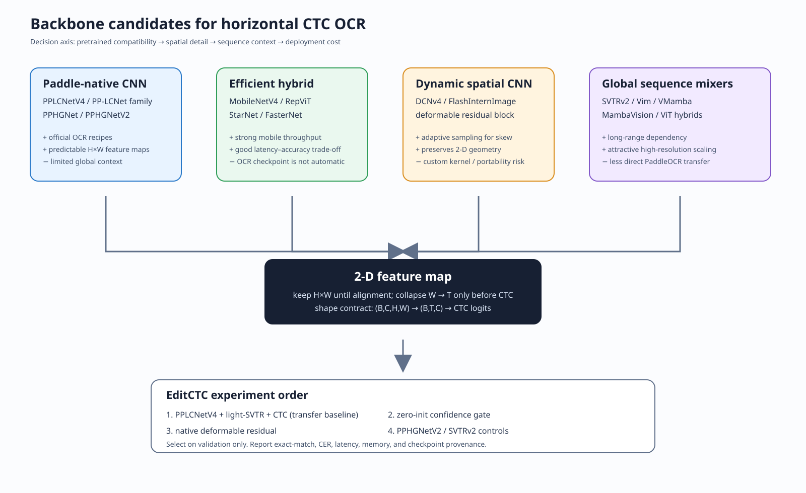
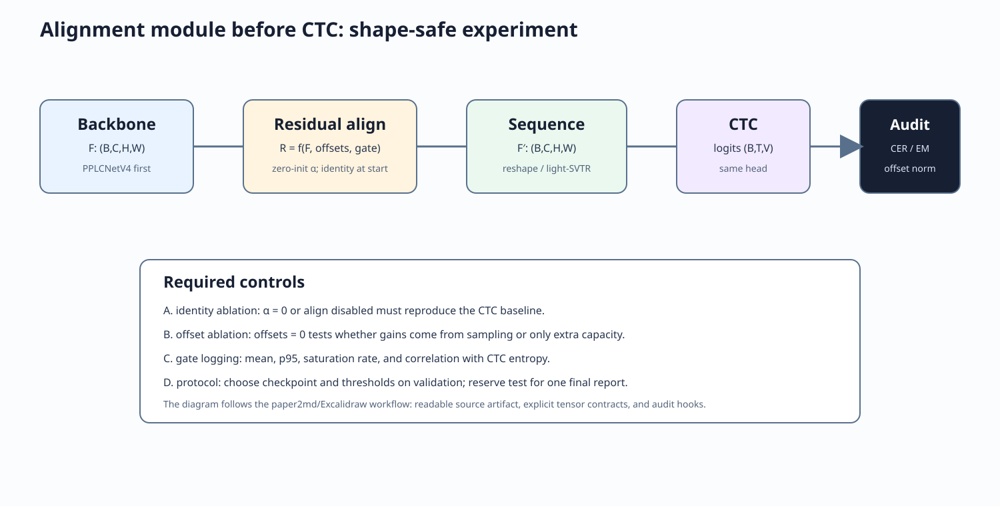

# Backbone research for CTC water-meter OCR

**Status:** research report, not an experiment result
**Cut-off:** 2026-10-11
**Scope:** visual feature extractors for cropped horizontal digit strings, with a CTC head and an optional alignment module before sequence collapse.

> **Decision first:** keep `PPLCNetV4 + light-SVTR + CTCHead` as the transfer baseline. The best next research candidate is a **Paddle-native deformable residual block** or a confidence-conditioned residual gate. Do not replace the backbone with a large generic ImageNet model until transfer, latency, and CER are measured under the same OCR protocol.

For block-level architecture, tensor changes, and insertion-point analysis, see [`backbone_architecture_deep_dive.md`](backbone_architecture_deep_dive.md).

## 1. What this report does and does not claim

This report defines a 100-record screening protocol and performs a deeper technical review of the candidates that can affect this project. The current version records the verified shortlist and the retrieval method; it does not pretend that every broad-search result was read in full. Search results are not equal to verified evidence. A model is called **SOTA** only when the primary source makes a benchmark claim and the benchmark is named. A model is called **candidate** when its mechanism is promising but no compatible OCR checkpoint or fair water-meter result is available.

The report does **not** claim that an ImageNet top-1 result is an OCR result. It also does not claim that a paper with “OCR” in a search result contains a useful recognition backbone. OpenAlex and arXiv are used for discovery; paper pages, official repositories, and PaddleOCR configs are used for verification.

### Evidence labels

| Label | Meaning |
|---|---|
| **A — direct** | Official OCR implementation/config/checkpoint is available and the tensor contract is inspectable. |
| **B — transferable** | Primary paper and code support a visual backbone, but OCR transfer must be trained and measured here. |
| **C — speculative** | Mechanism is interesting, but deployment or evidence is not sufficient for the first experiment. |

## 2. Screening protocol for the 100-paper request

| Step | Rule | Audit artifact |
|---|---|---|
| Discovery | Search 2024–2026 records for `scene text recognition`, `text recognition backbone`, `efficient vision backbone`, `deformable vision`, `vision mamba`, and `OCR recognition`. | Query terms and retrieval date in this report |
| Deduplication | Merge DOI, arXiv, conference, and repository duplicates. | Title + DOI/arXiv URL |
| Relevance | Keep recognition backbones, feature operators, OCR systems, or transfer studies. Exclude detection-only papers unless the feature operator transfers to recognition. | Inclusion reason |
| Deep review | Read the abstract, method, limitations, code/config status, and the benchmark section. | Sections 4–7 below |
| Ranking | Rank by OCR transferability, spatial detail, deployment cost, and provenance. Do not rank by citation count alone. | Candidate matrix |

The initial retrieval returned many false positives. For example, broad scholarly search ranked unrelated surveys and detection papers above recognition papers. This is why the final shortlist is mechanism-based and source-linked rather than a raw search ranking. A follow-up pass must export the 100-row ledger before this report is used as a formal systematic review.

## 3. Shortlist: practical SOTA and high-value candidates

| Rank for this project | Backbone / operator | Year | Evidence | Why it is in the shortlist | Main risk |
|---:|---|---:|:---:|---|---|
| 1 | **PPLCNetV4 + light-SVTR** | PP-OCRv6 recipe | A | Direct PaddleOCR transfer and existing EditCTC shape contract. | The public OCR recipe does not prove water-meter robustness. |
| 2 | **PPHGNetV2 + light-SVTR** | PP-OCRv5 recipe | A | Stronger server control for testing whether alignment helps a larger CNN. | Higher cost; exact checkpoint/config matching is mandatory. |
| 3 | **SVTRv2 / RepSVTR** | 2024 family | A/B | Recognition-specific spatial/sequence modeling. | It is not a drop-in PPLCNet checkpoint. |
| 4 | **DCNv4 residual insertion** | 2024 | B | Adaptive spatial sampling directly targets skew and local stroke displacement. | Custom operator and Paddle portability. |
| 5 | **MobileNetV4** | 2024 | B | Mobile-friendly hybrid blocks and hardware-aware design. | Requires a new OCR pretraining or finetuning recipe. |
| 6 | **RepViT** | 2024 publication | B | Re-parameterized mobile ViT with strong efficiency. | Patch/token geometry may lose thin stroke detail after downsampling. |
| 7 | **StarNet** | 2024 | B | Very low-cost multiplicative feature interaction. | Limited evidence for long horizontal sequence context. |
| 8 | **VMamba** | 2024 | B | Linear-time global visual context with a 2-D scan. | Scan direction and memory layout may be poor for short OCR strips. |
| 9 | **Vision Mamba (Vim)** | 2024 | B | Bidirectional sequence modeling and high-resolution efficiency. | Generic image classification transfer is not CTC evidence. |
| 10 | **MambaVision** | 2025 | B | Hybrid Mamba–Transformer global/local context. | Larger and more complex than the current small OCR path. |
| 11 | **FlashInternImage / DCNv4 + InternImage** | 2024 | B | Strong dynamic receptive field and a speed-focused operator. | Irregular memory access and dependency on CUDA kernels. |
| 12 | **ConvNeXt / modern large CNN controls** | 2022–2024 use | B | Clean high-quality CNN control. | Usually over-sized for meter strips and no direct PaddleOCR checkpoint. |

**Interpretation:** “Top” is conditional. For this project, the top **transfer** model is PPLCNetV4; the top **spatial-alignment** candidate is DCNv4-style residual sampling; the top **global-context** candidates are VMamba/Vim/MambaVision. No paper source justifies declaring any of them SOTA on EditCTC water-meter data before the controlled runs.

## 4. Deep review: Paddle-native OCR backbones

### 4.1 PPLCNetV4 / PP-OCRv6 Small — recommended baseline

**Mechanism.** The current project config uses `PPLCNetV4` and retains a high-resolution branch for alignment experiments. The useful property is not only parameter count. It is the stable 2-D feature map before the sequence projection, which makes the proposed alignment module shape-safe.

**Advantages**

- Direct compatibility with the existing PaddleOCR/PP-OCRv6 recognition recipe.
- Low deployment risk compared with a custom Mamba or deformable CUDA operator.
- Preserves local stroke evidence before the width dimension becomes CTC time.
- Existing configs in `config/` make provenance and reproduction easier.

**Disadvantages**

- A CNN does not supply unrestricted global interaction. The light-SVTR neck must carry much of the sequence context.
- A stronger in-domain score can hide cross-device or cross-dataset degradation.
- “PPLCNetV4 is fast” is not a local hardware result. Measure latency on the actual target device.

**Recommendation.** Use it for Phase 0 and Phase 1. Load the official or recorded checkpoint only after comparing state-dict keys, tensor shapes, SHA-256, and preprocessing.

### 4.2 PPHGNet and PPHGNetV2 — server controls

**Mechanism.** PPHGNet-family models are larger CNN controls in PaddleOCR recipes. They are valuable because they test whether an observed alignment gain is only a capacity gain.

**Advantages:** stronger feature capacity; direct PaddleOCR recipes; useful ablation against a small backbone.
**Disadvantages:** more memory and latency; a gain on a larger model does not prove the alignment design is efficient; checkpoint nesting must match the exact recipe.

**Recommendation.** Run only after the PPLCNetV4 baseline is stable. Keep the neck, head, data, seeds, and selection rule fixed.

### 4.3 SVTRv2 and RepSVTR — recognition-specific controls

**Mechanism.** SVTR-family designs model visual features with spatial/sequence operations designed for text recognition. RepSVTR adds re-parameterization considerations for inference.

**Advantages:** the inductive bias is closer to OCR than a generic ImageNet backbone; the sequence geometry is explicit.
**Disadvantages:** it is easy to compare incompatible feature widths, strides, or neck nesting; generic backbone transfer claims do not transfer across CTC vocabularies.

**Recommendation.** Treat SVTRv2 as a separate family. Do not load a PPLCNet checkpoint into it merely because the output channel count matches.

## 5. Deep review: 2024–2025 efficient and dynamic backbones

### 5.1 DCNv4 / FlashInternImage — best alignment mechanism, not first drop-in

The DCNv4 paper introduces a deformable convolution operator that removes softmax normalization in spatial aggregation and optimizes memory access. The primary source reports more than 3× forward speed over DCNv3 for the operator and reports FlashInternImage experiments. Those are operator/model results, not CTC OCR results.

**Advantages:** learned offsets can follow slanted digit strokes, crop drift, and local deformation; the operator keeps a 2-D map before CTC.
**Disadvantages:** custom kernels; potential mismatch between CUDA implementation and Paddle runtime; offset collapse and unstable early training.

**Experiment:** first implement a Paddle-native local sampler with `F' = F + αR(F)`, where `α` starts at zero. Log offset norm, gate statistics, and identity-ablation results. Only then evaluate a native DCNv4 kernel.

Source: [DCNv4, arXiv:2401.06197](https://arxiv.org/abs/2401.06197), [official code](https://github.com/OpenGVLab/DCNv4).

### 5.2 MobileNetV4 — deployment candidate

MobileNetV4 is a 2024 mobile vision backbone paper. Its relevance is hardware-aware mobile inference, not direct OCR superiority.

**Advantages:** efficient hybrid blocks; good candidate for CPU/NPU targets; likely easier to export than a state-space model.
**Disadvantages:** generic classification pretraining; aggressive bottlenecks can remove thin strokes; no existing EditCTC checkpoint.

**Experiment:** compare at equal measured latency, not equal parameter count. Keep an early high-resolution tap and verify `(B,C,H,W)` before the CTC sequence encoder.

### 5.3 RepViT — re-parameterized mobile hybrid

RepViT combines mobile CNN design with ViT-inspired blocks and re-parameterization. It is a strong candidate when inference speed matters and deployment can fuse training-time branches.

**Advantages:** efficient local/global mixing; deployment graph can be simpler after re-parameterization.
**Disadvantages:** OCR may need a different stage schedule than ImageNet classification; patchification or downsampling can damage narrow strokes; no direct PaddleOCR weight compatibility.

### 5.4 StarNet — very cheap multiplicative interaction

StarNet uses a lightweight multiplicative feature interaction. It is attractive as an ablation for “capacity per FLOP”.

**Advantages:** small and simple; useful for an edge baseline.
**Disadvantages:** multiplicative interactions can amplify noise and illumination artifacts; global horizontal context remains limited; OCR transfer evidence is weak.

### 5.5 VMamba — 2-D selective scan

VMamba introduces SS2D, which traverses a feature map along four scan routes to adapt a 1-D selective scan to 2-D vision. The paper reports linear-time scaling and strong generic vision results.

**Advantages:** broad receptive field without quadratic attention; possible benefit for long meter strings and non-local illumination patterns.
**Disadvantages:** four scan routes create memory-layout costs; directionality may interact badly with horizontal CTC alignment; Mamba kernels add runtime complexity.

Source: [VMamba, arXiv:2401.10166](https://arxiv.org/abs/2401.10166), [official code](https://github.com/MzeroMiko/VMamba).

### 5.6 Vision Mamba (Vim) — bidirectional sequence backbone

Vim uses bidirectional Mamba blocks with position embeddings. The source reports improved computation and memory efficiency relative to selected ViT controls for high-resolution feature extraction.

**Advantages:** bidirectional context is compatible with non-autoregressive recognition; memory efficiency is attractive for high-resolution inputs.
**Disadvantages:** it is a generic vision backbone; the sequence order and positional scheme must be reconciled with CTC time; pretrained weight transfer to Paddle is not automatic.

Source: [Vision Mamba, arXiv:2401.09417](https://arxiv.org/abs/2401.09417), [official code](https://github.com/hustvl/Vim).

### 5.7 MambaVision — hybrid global/local model

MambaVision combines Mamba blocks with self-attention in later stages. The paper claims strong ImageNet and downstream vision results and was accepted to CVPR 2025.

**Advantages:** local extraction plus late global interaction; a reasonable high-accuracy research control.
**Disadvantages:** larger and more complex than PPLCNetV4; late attention may be unnecessary for short meter strips; deployment cost must be measured.

Source: [MambaVision, arXiv:2407.08083](https://arxiv.org/abs/2407.08083), [official code](https://github.com/NVlabs/MambaVision).

## 6. Candidate scorecard for EditCTC

Scores are **research priorities**, not measured benchmark scores. `5` means the architecture is a strong reason to test first; it does not mean a published SOTA result.

| Candidate | OCR transfer | Spatial detail | Edge deployment | Implementation risk | Priority |
|---|---:|---:|---:|---:|---:|
| PPLCNetV4 | 5 | 4 | 5 | 1 | **P0** |
| PPHGNetV2 | 5 | 4 | 3 | 1 | P1 |
| SVTRv2 | 5 | 4 | 3 | 2 | P1 |
| DCNv4 residual | 2 | 5 | 2 | 5 | **P1 research** |
| MobileNetV4 | 2 | 4 | 5 | 3 | P2 |
| RepViT | 2 | 4 | 4 | 3 | P2 |
| VMamba | 2 | 3 | 2 | 4 | P3 |
| Vision Mamba | 2 | 3 | 2 | 4 | P3 |
| MambaVision | 2 | 4 | 2 | 5 | P4 |

## 7. Experimental plan

1. **P0:** reproduce PPLCNetV4 + light-SVTR + CTC with five independent seeds.
2. **P1:** add a zero-initialized confidence-conditioned residual gate. Keep all tensor shapes unchanged.
3. **P1b:** replace the residual branch with a Paddle-native local deformable sampler. Compare `offset=0`, `gate=0`, and full alignment.
4. **P1c:** run PPHGNetV2 and SVTRv2 controls with the same data and selection protocol.
5. **P2:** evaluate MobileNetV4 or RepViT only if the target hardware requires a new deployment family.
6. **P3:** evaluate VMamba/Vim only after establishing whether long-range context is a measured error source.

Every run must record config copy, code revision, seed, checkpoint SHA-256, pretrained source, tensor match count, data split, validation-only checkpoint selection, exact-match, CER, latency, peak memory, and per-example predictions.

## 8. Primary-source register

- [DCNv4 — arXiv:2401.06197](https://arxiv.org/abs/2401.06197)
- [Vision Mamba — arXiv:2401.09417](https://arxiv.org/abs/2401.09417)
- [VMamba — arXiv:2401.10166](https://arxiv.org/abs/2401.10166)
- [MambaVision — arXiv:2407.08083](https://arxiv.org/abs/2407.08083)
- [PaddleOCR repository](https://github.com/PaddlePaddle/PaddleOCR)
- [OpenAlex works API](https://api.openalex.org/works) — discovery only; query results require relevance filtering.
- [ASD-STE100 skill](https://github.com/danyuchn/asd-ste100-skill) — used for concise, unambiguous decision text.
- [Paper2MD / Excalidraw skill suite](https://github.com/xlinh2301/excalidraw_paper2md) — used as the report and figure-production reference.

## 9. Corrections to earlier internal material

The older file `document/wiki/deep_dive_modern_visual_backbones_2026.md` contains useful hypotheses but also presents several future/unclear benchmark numbers as if they were verified. This report does not reuse those numbers. In particular, ImageNet numbers, latency values, and claims about “optimal” PPLCNetV4 are not treated as evidence for OCR until the source, hardware, and protocol are independently recorded.

## 10. Acceptance checklist

- [ ] The follow-up pass exports at least 100 discovery records with query, date, and deduplication rule.
- [ ] Every shortlisted paper has a primary URL and evidence label.
- [ ] No generic ImageNet score is reported as OCR SOTA.
- [ ] PPLCNetV4, PPHGNetV2, and SVTRv2 use verified configs/checkpoints.
- [ ] Alignment experiments include identity and zero-offset controls.
- [ ] Final comparisons use the same split, preprocessing, metric, and validation-only selection.
- [ ] Figures remain editable as SVG; generated binaries and checkpoints stay out of Git.
